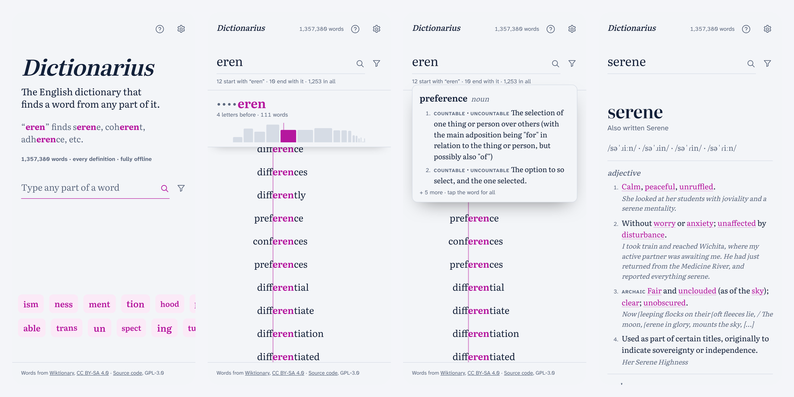

# Dictionarius 📖

A free, fully offline English dictionary that finds a word from any part of it, as you type.

[](https://github.com/smitravitz/Dictionarius/actions/workflows/ci.yml)
[](https://github.com/smitravitz/Dictionarius/releases/latest)
[](LICENSE)

Type `eren` and get *serene*, *coherent*, *adherence*: every word with your letters anywhere inside, not just at the start, on screen in about a millisecond. All 1,357,380 English words and their definitions from Wiktionary live on your device. No account, no network, no permissions.

<picture>
  <source media="(prefers-color-scheme: dark)" srcset="docs/screenshots/app-dark.png">
  
</picture>

**[Open it in your browser](https://smitravitz.github.io/Dictionarius/)** · **[Get the Android app](#android)**

## ✨ Features

- ⚡ **Instant.** Results appear as you type: the first screen in about a millisecond across all 1,357,380 words, with no server to wait for (measured under **How it works**).
- 🔎 **Search inside words.** Any piece of a word finds every word containing it, lined up on your letters: the exact word, then words that start with it, then those with one letter before it, two, and so on. A summary counts how many start with, end with and contain it.
- ↔️ **Slide to move the piece.** Hold the space beside a word and slide to jump to words where your letters land later or earlier; a frequency graph shows how many there are at each place. Alt+←/→ does the same from a keyboard.
- 👀 **Peek.** Hold a word for its first meanings; let go and they're gone.
- 📚 **Full entries.** Tap a word for its meanings, an example of each in use, pronunciation and origin. Words inside a definition open their own entries, and a swipe (or the back and forward buttons) steps through the words you followed.
- 🎚️ **Filters and settings.** Word length with two roller wheels; safe search, phrases and names in Settings (common words only by default).
- 🧭 **Shows you how.** A five-step tour on first run, and **How It Works** behind the **?** any time.
- 🔒 **Private by design.** The Android app requests no permissions at all: no network, no storage, no sensors. CI checks every build against [`privacy.toml`](privacy.toml).

## 📲 Install

### Web

**[smitravitz.github.io/Dictionarius](https://smitravitz.github.io/Dictionarius/)** runs the latest release. It opens in moments: the start screen and its suggestions come from a small starter file while the word list (14 MB, compressed) loads behind it, and word pages load one at a time as you open them. In the background it then saves everything on your device, about 70 MB, so later visits download nothing and work offline (Settings shows when that's done). The page loads only its own files and sends nothing anywhere, though GitHub, which hosts it, sees your visit as any host does.

### Android

Needs Android 7.0 or later. Add `https://github.com/smitravitz/Dictionarius` to [Obtainium](https://obtainium.imranr.dev) to install and get updates, or download the APK (about 73 MB) from the [latest release](https://github.com/smitravitz/Dictionarius/releases/latest). Everything is inside it: nothing is downloaded later.

## ⚙️ How it works

Search runs on an **FM-index**, a compressed index that *is* the word list, so finding a piece anywhere in a word costs no more than finding its start. There's no server and no database to wait for:

| Searching all 1,357,380 words | Median | Slowest |
|---|---|---|
| First screen of results | 1.2 ms | 57 ms (a single letter) |
| Every match counted, for the totals and the graph (in the background, never in the way) | 24 ms | 1.3 s (a single letter) |
| Opening the word list | 44 ms | |

These are the search code's own times on one 2.3 GHz server core, over every letter and start-screen suggestion; a phone is slower. Run them yourself with `npm run bench:speed`. The index is small too: on a 370,105-word benchmark it was about 2.3× smaller than SQLite's FTS5 trigram index ([`bench/`](bench/README.md)).

Definitions are packed by word id and compressed with brotli in blocks, so opening a word unpacks one small block; the app reads blocks straight from the APK as it needs them ([ADR-0004](docs/adr/0004-all-definitions-bundled.md), [ADR-0005](docs/adr/0005-layered-data-packs.md)).

| What's inside (current data) | Size |
|---|---|
| Word index: 1,357,380 search keys | 33 MB |
| Meanings, labels and links | 34 MB |
| Examples | 13 MB |
| Origins | 8.5 MB |
| Pronunciations | 1.1 MB |

The formats are documented in [`docs/index-format.md`](docs/index-format.md) and [`docs/definitions-format.md`](docs/definitions-format.md); every design decision has a record in [`docs/adr/`](docs/adr/).

## 🗺️ Status and roadmap

Actively developed: Android and web releases ship from this repository ([releases](https://github.com/smitravitz/Dictionarius/releases)). Planned, not built yet:

- PWA, iOS and F-Droid builds
- Translations, French first ([ADR-0005](docs/adr/0005-layered-data-packs.md))
- Search by letter pattern, such as a letter in a given place ([ADR-0006](docs/adr/0006-letter-and-position-bitmaps.md))
- Pronunciations for words that don't have one yet, worked out from their parts where that's reliable ([ADR-0007](docs/adr/0007-derived-pronunciations.md))

## 🛠️ Development

Needs Node 22 or later (CI runs 22 and 24). Python is only needed to build the word index.

```bash
npm install
npm test                        # unit tests
npm run typecheck               # strict TypeScript
npx playwright install chromium # once, for the browser tests
npm run test:e2e                # browser tests: desktop, phone, and everything again with the tour on
```

Run the app on the small sample word list that the tests use, then open <http://localhost:5173/?index=headwords-sample.bin>:

```bash
DICTIONARIUS_PUBLIC="$PWD/test/fixtures" npm run dev
```

For the full word list, download a data release (the newest `data-…` one on the [releases page](https://github.com/smitravitz/Dictionarius/releases); `data-b0d819c2` goes with v0.6.2), then open <http://localhost:5173/>:

```bash
gh release download data-b0d819c2 -R smitravitz/Dictionarius -D release-data
DICTIONARIUS_PUBLIC="$PWD/release-data" npm run dev
```

`DICTIONARIUS_PUBLIC` must be an absolute path. [`docs/development.md`](docs/development.md) covers building the data from the Wiktionary dump, the Android app and releasing. New here? Start with [`docs/handoff.md`](docs/handoff.md); [`CONTEXT.md`](CONTEXT.md) defines the project's terms.

## 📄 License

- **Code:** [GPL-3.0-or-later](LICENSE).
- **Dictionary data:** from [English Wiktionary](https://en.wiktionary.org) via [wiktextract](https://github.com/tatuylonen/wiktextract), redistributed under [CC BY-SA 4.0](https://creativecommons.org/licenses/by-sa/4.0/) with attribution; see [`data/README.md`](data/README.md).
- **Fonts:** [Literata](https://www.npmjs.com/package/@fontsource-variable/literata) and [Atkinson Hyperlegible Next](https://www.npmjs.com/package/@fontsource/atkinson-hyperlegible-next), both under the SIL Open Font License 1.1.

Coding agents: project instructions are in [`.claude/CLAUDE.md`](.claude/CLAUDE.md).
